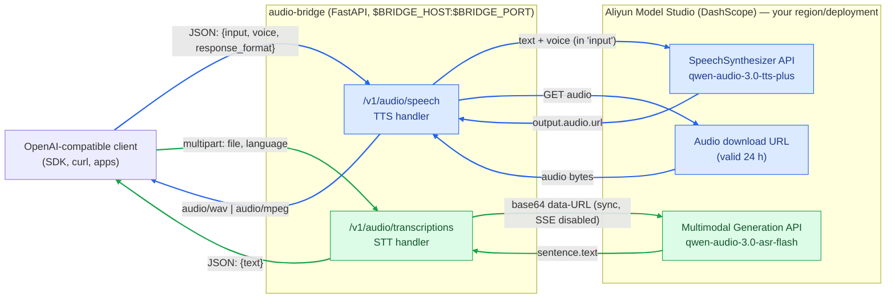

# DashScope ↔ OpenAI Audio Bridge

[](LICENSE)

A lightweight FastAPI service that exposes **OpenAI-compatible audio endpoints** backed by
[Alibaba Cloud Model Studio (DashScope)](https://www.alibabacloud.com/help/en/model-studio/)
Qwen-Audio models. Works with any DashScope deployment — mainland China, International, or
Token Plan — by pointing `ALI_TTS_URL` / `ALI_STT_URL` at your API host.

Point any OpenAI SDK or client at this bridge and use Aliyun TTS/ASR models as if they were
OpenAI audio models.

| OpenAI-compatible endpoint | Backed by | Model (default) |
|---|---|---|
| `POST /v1/audio/speech` (TTS) | DashScope `SpeechSynthesizer` | `qwen-audio-3.0-tts-plus` |
| `POST /v1/audio/transcriptions` (STT) | DashScope multimodal generation | `qwen-audio-3.0-asr-flash` |
| `GET /health` | — | service status |

## Architecture



_Blue: TTS flow (`/v1/audio/speech`) · Green: STT flow (`/v1/audio/transcriptions`)_

<details>
<summary>ASCII version (if Mermaid does not render)</summary>

```
+------------------+        JSON / multipart         +-----------------------------+
| OpenAI-compatible| ------------------------------> |  audio-bridge (FastAPI)     |
| client (SDK,curl)| <------------------------------ |  $BRIDGE_HOST:$BRIDGE_PORT  |
+------------------+     audio bytes / {"text":..}   +--------------+--------------+
                                                                    |
                            DashScope HTTPS (any region), Bearer API key
                                                                    v
                             +----------------------------------------------+
                             | Aliyun Model Studio                          |
                             |  TTS: /api/v1/services/audio/tts/            |
                             |       SpeechSynthesizer  (tts-plus)          |
                             |       -> output.audio.url -> download bytes  |
                             |  STT: /api/v1/services/aigc/                 |
                             |       multimodal-generation/generation       |
                             |       (asr-flash, sync, base64 data-URL)     |
                             |       -> sentence.text                       |
                             +----------------------------------------------+
```
</details>

### Request flow

1. **TTS** — the client sends OpenAI-style JSON (`input`, optional `voice`/`response_format`/`sample_rate`).
   The bridge calls the DashScope synthesizer (voice/format go **inside `input`**), receives a temporary
   download URL (`output.audio.url`, valid 24 h), fetches the audio, and streams the bytes back with the
   proper `Content-Type`.
2. **STT** — the client uploads an audio file (multipart). The bridge base64-encodes it as a
   `data:audio/...;base64,` URL, calls the ASR model **synchronously** (no polling), and returns
   `{"text": "..."}`. Limits: ≤ 10 MB encoded audio, ≤ 5 min duration.

## Quick start

### Prerequisites

- Python 3.10+ (or Docker)
- An Alibaba Cloud Model Studio (DashScope) API key — from any region/deployment
  (mainland China, International, Token Plan) — with `qwen-audio-3.0-tts-plus`
  and `qwen-audio-3.0-asr-flash` (or equivalent audio models) enabled

### 1. Configure

```bash
cp .env.example .env      # then put your real key into ALI_API_KEY
source .env               # .env uses "export KEY=value" lines
```

`.env` is gitignored — never commit your key.

### 2a. Run locally

```bash
python3 -m venv .venv
.venv/bin/pip install -r requirements.txt
.venv/bin/python audio-bridge.py       # listens on BRIDGE_HOST:BRIDGE_PORT from .env
```

### 2b. Run with Docker

```bash
docker compose up --build -d
docker compose logs -f audio-bridge
```

The image (`python:3.13-slim`) bakes in **no configuration defaults** — everything is injected
from `.env` via `env_file`, and `.dockerignore` keeps `.env` out of the image. `BRIDGE_PORT`
from `.env` also drives the published port mapping and the TCP healthcheck; if it is missing
the container exits immediately with a logged configuration error rather than serving
misconfigured traffic.

## Usage examples

### TTS with curl

```bash
curl -s -X POST http://localhost:4005/v1/audio/speech \
  -H 'Content-Type: application/json' \
  -d '{"model":"qwen-audio-3.0-tts-plus","input":"Hello from the DashScope audio bridge."}' \
  -o speech.wav
```

### STT with curl

```bash
curl -s -X POST http://localhost:4005/v1/audio/transcriptions \
  -F model=qwen-audio-3.0-asr-flash -F file=@speech.wav -F language=en
# {"text":"Hello from the DashScope audio bridge."}
```

### OpenAI Python SDK

```python
from openai import OpenAI

client = OpenAI(base_url="http://localhost:4005/v1", api_key="not-used")

with client.audio.speech.with_streaming_response.create(
    model="qwen-audio-3.0-tts-plus",
    voice="qwen-audio-3.0-tts-plus-loongjameszhao",
    input="Hello from the bridge!",
) as response:
    response.stream_to_file("speech.wav")

with open("speech.wav", "rb") as f:
    print(client.audio.transcriptions.create(model="qwen-audio-3.0-asr-flash", file=f))
```

> The bridge does not check inbound API keys; the `api_key` value above can be any non-empty string.

## Configuration (all via environment / `.env`)

The code has **no built-in defaults** — every variable below is required. On startup the bridge
validates all values (presence, types, ranges) and, if anything is wrong, logs one clear message
per problem and exits with code `2` instead of serving a misconfigured API.

| Variable | Example | Description |
|---|---|---|
| `ALI_API_KEY` | `sk-…` | Aliyun Model Studio (DashScope) API key |
| `BRIDGE_HOST` | `0.0.0.0` | Interface the bridge listens on |
| `BRIDGE_PORT` | `4005` | Port the bridge listens on (1–65535) |
| `ALI_TTS_URL` | `https://<dashscope-host>/api/v1/services/audio/tts/SpeechSynthesizer` | TTS endpoint (http/https URL) |
| `ALI_STT_URL` | `https://<dashscope-host>/api/v1/services/aigc/multimodal-generation/generation` | STT endpoint (http/https URL) |
| `TTS_VOICE` | `qwen-audio-3.0-tts-plus-loongjameszhao` | Default voice (news-anchor style male) |
| `TTS_FORMAT` | `wav` | Default output format (`wav`, `mp3`, …) |
| `TTS_SAMPLE_RATE` | `24000` | Output sample rate in Hz (1000–192000) |
| `REQUEST_TIMEOUT` | `120` | Upstream HTTP timeout in seconds (> 0) |
| `MAX_BASE64_BYTES` | `10485760` | Max base64-encoded upload size for ASR (API limit: 10 MB) |
| `LOG_LEVEL` | `INFO` | `DEBUG`, `INFO`, `WARNING`, `ERROR` or `CRITICAL` |

Per the OpenAI spec, `model` is **required in every request** (JSON body for TTS, multipart
form for STT) and selects the DashScope model to call. Optional per-request overrides with
env defaults (TTS only): `voice`, `response_format`, `sample_rate`; STT accepts an optional
`language` hint.

## Logging

Structured logs go to stdout (container-friendly):

- **Startup**: full effective configuration with the API key masked (`sk-sp-*** (114 chars)`).
- **Per request (INFO)**: TTS model/voice/format/text length and returned byte count;
  STT model/filename/size/format/language and recognized character count.
- **Rejected requests (WARNING)**: empty input, empty/oversized uploads, unknown file
  extensions, empty recognition results — each with the concrete reason.
- **Upstream failures (ERROR)**: HTTP status and response excerpt, or the network exception
  when DashScope is unreachable.
- **Invalid configuration (ERROR)**: one line per problem, then exit code `2`.

Set `LOG_LEVEL=DEBUG` to additionally log recognized STT text and health-check hits.
The API key is never logged in full.

## Voices

Default voice: `qwen-audio-3.0-tts-plus-loongjameszhao` (English news-anchor male).

- Base voices use the full name `qwen-audio-3.0-tts-plus-<suffix>` (597 exist; only ~8 are English).
- System voices use short names, e.g. `longanlingxin` (F, ZH+EN) and `longanlufeng` (M, ZH+EN).
- **Voices cannot be mixed across models.** A voice belonging to another model (e.g.
  `loongmary` from `qwen-audio-3.0-tts-flash`) returns `[cosyvoice:] Engine error [411]`.
- Explicit British/American accent voices (`Emily_v3.1`, `Eric_v3.1`, …) belong to
  `qwen-audio-3.1-tts-flash` — check whether that model is available on your account.

Docs: [voice list (EN)](https://www.alibabacloud.com/help/en/model-studio/qwen-audio-tts-voice-list) ·
[voice list (ZH, most complete)](https://help.aliyun.com/zh/model-studio/qwen-audio-tts-voice-list)

## Accepted audio formats (STT uploads)

`wav`, `mp3`, `aac`, `amr`, `flac`, `m4a`, `ogg`, `opus`, `wma` — detected from the file
extension (unknown extensions are sent as `wav`).

## Differences from the real OpenAI API

- No streaming responses (`stream=true` is ignored); TTS returns the whole audio body.
- `transcriptions` supports `verbose_json`/`srt`/`vtt` response formats: not implemented — always `{"text": ...}`.
- No `speed`/`instructions`/`prompt` parameters; `temperature` is ignored.
- No inbound authentication — keep the bridge on a trusted network.

## Troubleshooting

| Symptom | Cause / fix |
|---|---|
| Container/process exits at startup with `Invalid configuration` | A required env var is missing or invalid — each problem is listed in the log; fix `.env` (all variables are required, no code defaults) |
| `401 InvalidApiKey` from upstream | Key does not match the configured `ALI_TTS_URL`/`ALI_STT_URL` host (e.g. key issued for a different region/deployment) |
| `404` on TTS/STT | Requested model not available for your account/region |
| `400 'model' is required` | OpenAI spec requires `model` in every request — add it to the JSON body (TTS) or form (STT) |
| `[cosyvoice:] Engine error [411]` | Voice does not belong to the requested model — see [Voices](#voices) |
| `413 Audio too large` | Upload exceeds `MAX_BASE64_BYTES` (ASR limit: 10 MB / 5 min) |
| Empty `{"text": ""}` | Silent/unintelligible audio, or wrong `language` hint |

## Development

```bash
.venv/bin/python -m py_compile audio-bridge.py   # syntax check
.venv/bin/python audio-bridge.py                 # run
curl -s http://localhost:4005/health             # smoke test
```

## License

MIT — see [LICENSE](LICENSE).
