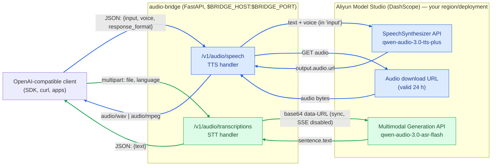

# DashScope ↔ OpenAI Audio Bridge

[](LICENSE)

A lightweight FastAPI service that exposes **OpenAI-compatible audio endpoints** backed by
[Alibaba Cloud Model Studio (DashScope)](https://www.alibabacloud.com/help/en/model-studio/)
Qwen-Audio models. Works with any DashScope deployment — mainland China, International, or
Token Plan — by pointing `ALI_TTS_URL` / `ALI_STT_URL` at your API host.

Point any OpenAI SDK or client at this bridge and use Aliyun TTS/ASR models as if they were
OpenAI audio models.

| OpenAI-compatible endpoint | Backed by | Model (default) |
|---|---|---|
| `POST /v1/audio/speech` (TTS) | DashScope `SpeechSynthesizer` | `qwen-audio-3.0-tts-plus` |
| `POST /v1/audio/transcriptions` (STT) | DashScope multimodal generation | `qwen-audio-3.0-asr-flash` |
| `GET /health` | — | service status |

## Architecture



_Blue: TTS flow (`/v1/audio/speech`) · Green: STT flow (`/v1/audio/transcriptions`)_

<details>
<summary>ASCII version (if Mermaid does not render)</summary>

```
+------------------+        JSON / multipart         +-----------------------------+
| OpenAI-compatible| ------------------------------> |  audio-bridge (FastAPI)     |
| client (SDK,curl)| <------------------------------ |  $BRIDGE_HOST:$BRIDGE_PORT  |
+------------------+     audio bytes / {"text":..}   +--------------+--------------+
                                                                    |
                            DashScope HTTPS (any region), Bearer API key
                                                                    v
                             +----------------------------------------------+
                             | Aliyun Model Studio                          |
                             |  TTS: /api/v1/services/audio/tts/            |
                             |       SpeechSynthesizer  (tts-plus)          |
                             |       -> output.audio.url -> download bytes  |
                             |  STT: /api/v1/services/aigc/                 |
                             |       multimodal-generation/generation       |
                             |       (asr-flash, sync, base64 data-URL)     |
                             |       -> sentence.text                       |
                             +----------------------------------------------+
```
</details>

### Request flow

1. **TTS** — the client sends OpenAI-style JSON (required `model`/`voice`/`input`, optional `response_format`/`sample_rate`).
   The bridge normalizes the text (strips markdown, bullets, emoji and hard line breaks that
   cause audible pauses — see [Smooth speech](#smooth-speech)), calls the DashScope synthesizer (voice/format go **inside `input`**), receives a temporary
   download URL (`output.audio.url`, valid 24 h), fetches the audio, and streams the bytes back with the
   proper `Content-Type`. For `opus`/`mp3` the bridge fetches `wav` upstream and re-encodes
   locally with ffmpeg (silence smoothing + a correct ogg granule clock — see
   [Why re-encode?](#why-re-encode)).
2. **STT** — the client uploads an audio file (multipart). The bridge base64-encodes it as a
   `data:audio/...;base64,` URL, calls the ASR model **synchronously** (no polling), and returns
   `{"text": "..."}`. Limits: ≤ 10 MB encoded audio, ≤ 5 min duration.

## Quick start

### Prerequisites

- Python 3.10+ (or Docker)
- **ffmpeg** in `PATH` — required for `opus`/`mp3` responses (local re-encode, see
  [Why re-encode?](#why-re-encode)); the Docker image installs it. Without ffmpeg the
  bridge still runs and passes upstream compressed audio through unchanged (logged as a
  warning at startup and per request)
- An Alibaba Cloud Model Studio (DashScope) API key — from any region/deployment
  (mainland China, International, Token Plan) — with `qwen-audio-3.0-tts-plus`
  and `qwen-audio-3.0-asr-flash` (or equivalent audio models) enabled

### 1. Configure

```bash
cp .env.example .env      # then put your real key into ALI_API_KEY
source .env               # .env uses "export KEY=value" lines
```

`.env` is gitignored — never commit your key.

### 2a. Run locally

```bash
python3 -m venv .venv
.venv/bin/pip install -r requirements.txt
.venv/bin/python audio-bridge.py       # listens on BRIDGE_HOST:BRIDGE_PORT from .env
```

### 2b. Run with Docker

```bash
docker compose up --build -d
docker compose logs -f audio-bridge
```

The image (`python:3.13-slim`) bakes in **no configuration defaults** — everything is injected
from `.env` via `env_file`, and `.dockerignore` keeps `.env` out of the image. `BRIDGE_PORT`
from `.env` also drives the published port mapping and the TCP healthcheck; if it is missing
the container exits immediately with a logged configuration error rather than serving
misconfigured traffic.

## Usage examples

### TTS with curl

```bash
curl -s -X POST http://localhost:4005/v1/audio/speech \
  -H 'Content-Type: application/json' \
  -d '{"model":"qwen-audio-3.0-tts-plus","voice":"qwen-audio-3.0-tts-plus-loongjameszhao","input":"Hello from the DashScope audio bridge."}' \
  -o speech.wav
```

### STT with curl

```bash
curl -s -X POST http://localhost:4005/v1/audio/transcriptions \
  -F model=qwen-audio-3.0-asr-flash -F file=@speech.wav -F language=en
# {"text":"Hello from the DashScope audio bridge."}
```

### OpenAI Python SDK

```python
from openai import OpenAI

client = OpenAI(base_url="http://localhost:4005/v1", api_key="not-used")

with client.audio.speech.with_streaming_response.create(
    model="qwen-audio-3.0-tts-plus",
    voice="qwen-audio-3.0-tts-plus-loongjameszhao",
    input="Hello from the bridge!",
) as response:
    response.stream_to_file("speech.wav")

with open("speech.wav", "rb") as f:
    print(client.audio.transcriptions.create(model="qwen-audio-3.0-asr-flash", file=f))
```

> The bridge does not check inbound API keys; the `api_key` value above can be any non-empty string.

## Configuration (all via environment / `.env`)

The code has **no built-in defaults** — every variable below is required (single exception:
`TTS_OPUS_BITRATE`, which defaults to `32`). On startup the bridge
validates all values (presence, types, ranges) and, if anything is wrong, logs one clear message
per problem and exits with code `2` instead of serving a misconfigured API.

| Variable | Example | Description |
|---|---|---|
| `ALI_API_KEY` | `sk-…` | Aliyun Model Studio (DashScope) API key |
| `BRIDGE_HOST` | `0.0.0.0` | Interface the bridge listens on |
| `BRIDGE_PORT` | `4005` | Port the bridge listens on (1–65535) |
| `ALI_TTS_URL` | `https://<dashscope-host>/api/v1/services/audio/tts/SpeechSynthesizer` | TTS endpoint (http/https URL) |
| `ALI_STT_URL` | `https://<dashscope-host>/api/v1/services/aigc/multimodal-generation/generation` | STT endpoint (http/https URL) |
| `TTS_FORMAT` | `opus` | Default TTS output format — one of `wav`, `mp3`, `opus`, `pcm` (`ogg` is accepted as an alias of `opus`; both are served as `audio/ogg`) |
| `TTS_SAMPLE_RATE` | `24000` | Output sample rate in Hz (1000–192000) |
| `TTS_OPUS_BITRATE` | `32` | Optional. Bitrate in kbps for locally re-encoded opus output (6–510; default `32`, matching DashScope's documented opus default) |
| `REQUEST_TIMEOUT` | `120` | Upstream HTTP timeout in seconds (> 0) |
| `MAX_BASE64_BYTES` | `10485760` | Max base64-encoded upload size for ASR (API limit: 10 MB) |
| `TTS_SILENCE_CAP_MS` | `250` | Cap for internal silences in TTS output, in ms — applies to **all** formats (opus/mp3 need ffmpeg); `0` disables smoothing (0–10000) |
| `LOG_LEVEL` | `INFO` | `DEBUG`, `INFO`, `WARNING`, `ERROR` or `CRITICAL` |

Per the OpenAI spec, `model` is **required in every request** (JSON body for TTS, multipart
form for STT) and `voice` is **required for TTS**; they select the DashScope model and voice
to call. Optional per-request overrides with env defaults (TTS only): `response_format`,
`sample_rate`; `speed` is forwarded as the upstream `rate`. STT accepts an optional
`language` hint. Overrides are validated: `response_format` must be one of `wav`, `mp3`,
`opus`, `pcm` (the set the upstream engine supports; `ogg` is accepted as an alias of
`opus` because the OpenAI ecosystem colloquially calls the format "ogg") and `sample_rate`
must be within 1000–192000 Hz — anything else is rejected with `400`.

## Logging

Structured logs go to stdout (container-friendly):

- **Startup**: full effective configuration with the API key masked (`sk-sp-*** (114 chars)`).
- **Per request (INFO)**: TTS model/voice/format/text length and returned byte count;
  STT model/filename/size/format/language and recognized character count.
- **Rejected requests (WARNING)**: empty input, empty/oversized uploads, unknown file
  extensions, empty recognition results — each with the concrete reason.
- **Upstream failures (ERROR)**: HTTP status and response excerpt, or the network exception
  when DashScope is unreachable.
- **Invalid configuration (ERROR)**: one line per problem, then exit code `2`.

Set `LOG_LEVEL=DEBUG` to additionally log recognized STT text and health-check hits.
The API key is never logged in full.

## Voices

Every TTS request must pass a `voice`. The examples use `qwen-audio-3.0-tts-plus-loongjameszhao`
(English news-anchor male).

- **Voice names are passed through verbatim** — the bridge does not map OpenAI stock voices
  (`alloy`, `echo`, `nova`, …) to DashScope voices. Always send a DashScope voice ID; an
  OpenAI name reaches the engine unmapped and fails with `[cosyvoice:] Engine error [411]`.
- Base voices use the full name `qwen-audio-3.0-tts-plus-<suffix>` (597 exist; exactly 8 are
  English — full table in [`docs/qwen-audio-tts-reference.md`](docs/qwen-audio-tts-reference.md#voices)).
- System voices use short names, e.g. `longanlingxin` (F, ZH+EN) and `longanlufeng` (M, ZH+EN).
- **Voices cannot be mixed across models.** A voice belonging to another model (e.g.
  `loongmary` from `qwen-audio-3.0-tts-flash`) returns `[cosyvoice:] Engine error [411]`.
- Explicit British/American accent voices (`Emily_v3.1`, `Eric_v3.1`, …) belong to
  `qwen-audio-3.1-tts-flash` — check whether that model is available on your account.

Docs: [voice list (EN)](https://www.alibabacloud.com/help/en/model-studio/qwen-audio-tts-voice-list) ·
[voice list (ZH, most complete)](https://help.aliyun.com/zh/model-studio/qwen-audio-tts-voice-list)

## Accepted audio formats (STT uploads)

`wav`, `mp3`, `aac`, `amr`, `flac`, `m4a`, `ogg`, `opus`, `wma` — detected from the file
extension (unknown extensions are sent as `wav`).

## Smooth speech

TTS models insert audible pauses or stumbles at markdown decorations (`#`, `**`, `-` bullets),
emoji, hard line breaks and unit symbols — all common in LLM output such as weather forecasts.
Measured on a real forecast sample (~30 s of speech): ~15–20 internal pauses (≥ 250 ms) raw
vs. typically ~6–12 after cleanup. (Synthesis is stochastic — exact counts vary per run.)

The bridge therefore normalizes every `input` before synthesis:

- strips emoji, markdown marks and bullet prefixes (`-`, `*`, `1.`, `>`, …)
- converts line breaks into sentence breaks (or spaces after punctuation)
- verbalizes numeric ranges (`10-15` → "10 to 15"; dates and phone numbers are left alone)
- expands units: `°C`/`°F`, `N%`, `km/h`, `mph`, `m/s`
- replaces dashes (`–`, `—`), ellipses and semicolons with lighter punctuation

Plain prose passes through unchanged. For best results also send speakable text from your
client: prefer words over symbols ("23 degrees" not "23°") and keep sentences short.

### Silence smoothing

Even with clean text the CosyVoice engine behind Qwen-Audio-TTS inserts stochastic prosodic
silences (250–900 ms) at punctuation — no upstream parameter removes them (SSML `<break>`,
`language_hints` and `instruction` were all measured to make pauses worse or no better). The
maintainer-recommended fix is postprocessing, so the bridge shortens every internal silence
longer than `TTS_SILENCE_CAP_MS` (default recommendation: `250`; `0` disables) in **every
response format**, with a 4 ms crossfade at each cut: `wav`/`pcm` directly, `opus`/`mp3`
inside the ffmpeg re-encode pipeline below (without ffmpeg, compressed formats pass through
unsmoothed). Measured on a forecast sample: pauses capped from up to 990 ms to a
uniform 250 ms with speech fully intelligible (verified by ASR roundtrip).

### Why re-encode?

`opus`/`mp3` responses are fetched from DashScope as `wav` and re-encoded locally with
ffmpeg (`libopus` at `TTS_OPUS_BITRATE` kbps / `libmp3lame -q:a 4`). Two reasons, both
measured against the live upstream:

1. **DashScope's ogg/opus muxer writes a broken granule clock.** RFC 7845 §4 requires a
   page's granulepos to equal the total PCM sample count up to that page. DashScope advances
   granulepos by **4800 per page (100 ms) while each page carries one 2880-sample (60 ms)
   packet — a constant 5:3 inflation** (measured: a file claiming 22.20 s contains 13.30 s of
   decoded PCM; another claimed 46.40 s vs 27.82 s real). Players that build the playback
   timeline from granulepos — including Telegram's voice-note player — receive 60 ms of audio
   per 100 ms of timeline, producing ~40 ms dropouts ≈ 16×/second ("fast interruptions in
   speech"). Remuxing (`ffmpeg -c:a copy`) does **not** repair it; only decode → re-encode
   rewrites a correct clock (verified: granule/PCM ratio 1.000 after re-encode, container
   duration within 0.007 s of decoded PCM).
2. **Silence smoothing needs PCM**, which the re-encode pipeline has anyway (see above).

If ffmpeg is missing or a subprocess fails/times out (30 s), the bridge logs
`re-encode unavailable (…) - returning upstream audio unchanged` and passes the upstream
bytes through — the service never crashes over a missing binary. ffmpeg availability is
logged once at startup.

Additionally, the OpenAI `speed` parameter is forwarded as the upstream `rate` (clamped to
the supported 0.5–2.0); values around 1.15–1.25 measurably shorten prosodic pauses.

The upstream synthesizer exposes further quality parameters (`pitch`, `volume`,
`language_hints`, `hot_fix`, `instruction`, SSML, …) that the bridge does not forward yet —
see [`docs/qwen-audio-tts-reference.md`](docs/qwen-audio-tts-reference.md) for the full
parameter and limits reference with official documentation links.

## Differences from the real OpenAI API

- `model` and `voice` are **pass-through DashScope identifiers** — no translation of OpenAI
  names (`gpt-4o-mini-tts`, `alloy`, …); requests must target DashScope models/voices directly.
- No streaming responses (`stream=true` is ignored); TTS returns the whole audio body.
- TTS `response_format` is limited to the upstream-supported set (`wav`, `mp3`, `opus`,
  `pcm`, plus `ogg` as an alias of `opus`); OpenAI's `aac`/`flac` are rejected with `400`.
  `opus`/`mp3` bodies are locally re-encoded, so bytes differ from what DashScope would
  return directly (correct granule clock, silence cap applied — see
  [Why re-encode?](#why-re-encode)).
- `transcriptions` supports `verbose_json`/`srt`/`vtt` response formats: not implemented — always `{"text": ...}`.
- `speed` is forwarded as the upstream `rate`, clamped to 0.5–2.0 (upstream limit);
  `instructions`/`prompt` are not supported; `temperature` is ignored.
- TTS `input` text is normalized before synthesis (see [Smooth speech](#smooth-speech)) — a
  deliberate extension; the real OpenAI API speaks the text verbatim.
- No inbound authentication — keep the bridge on a trusted network.

## Troubleshooting

| Symptom | Cause / fix |
|---|---|
| Container/process exits at startup with `Invalid configuration` | A required env var is missing or invalid — each problem is listed in the log; fix `.env` (all variables are required, no code defaults) |
| `401 InvalidApiKey` from upstream | Key does not match the configured `ALI_TTS_URL`/`ALI_STT_URL` host (e.g. key issued for a different region/deployment) |
| `404` on TTS/STT | Requested model not available for your account/region |
| `400 'model'/'voice' is required` | OpenAI spec requires `model` in every request and `voice` for TTS — add them to the JSON body (TTS) or form (STT) |
| `[cosyvoice:] Engine error [411]` | Voice does not belong to the requested model, or is an OpenAI stock name (`alloy`, …) — names pass through unmapped, see [Voices](#voices) |
| `413 Audio too large` | Upload exceeds `MAX_BASE64_BYTES` (ASR limit: 10 MB / 5 min) |
| Empty `{"text": ""}` | Silent/unintelligible audio, or wrong `language` hint |
| Short pauses/breaks in TTS audio | The engine inserts stochastic prosodic silences at punctuation (not transport). The bridge normalizes text and caps silences at `TTS_SILENCE_CAP_MS` in all formats — see [Smooth speech](#smooth-speech). Try `speed` ≈ 1.15–1.25 or a different voice |
| Choppy playback / rapid dropouts in players (e.g. Telegram voice notes) | Upstream opus files carry a 5:3-inflated ogg granule clock. Make sure the bridge has ffmpeg (startup log line `ffmpeg found …`) so responses are re-encoded — see [Why re-encode?](#why-re-encode) |
| Log shows `re-encode unavailable (…) - returning upstream audio unchanged` | ffmpeg is missing or a transcode failed/timed out; opus/mp3 responses pass through with the broken upstream granule clock and no silence smoothing. Install ffmpeg (Docker image includes it) |

## Development

```bash
.venv/bin/python -m py_compile audio-bridge.py   # syntax check
.venv/bin/python audio-bridge.py                 # run
curl -s http://localhost:4005/health             # smoke test

.venv/bin/python -m pip install -r requirements-dev.txt   # test dependencies (pytest)
.venv/bin/python -m pytest tests -q                       # unit + endpoint tests (no network)
```

The re-encode pipeline tests use a real ffmpeg and are skipped automatically when it is not
on `PATH`; all other tests run without it.

## License

MIT — see [LICENSE](LICENSE).
